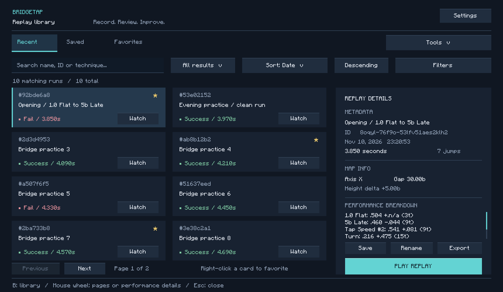

# BridgeTap

A **Minecraft 1.8.9** client mod for analyzing your bridges: jump coordinates, run history, and replays with a free camera, a ghost player, and first-person playback.

[Download the latest version](https://github.com/sgggnnn/bridgetap/releases/latest) · [All releases](https://github.com/sgggnnn/bridgetap/releases) · [Changelog](CHANGELOG.md) · [Report a bug](https://github.com/sgggnnn/bridgetap/issues)

**1.6.0** promotes the tested dev.11 build to the final release. It adds island scenery and one-click presets, MP4 clips with Windows output audio, a replay file manager, protected saves, block appearance customization and Focus mode. See the [islands and clips guide](docs/ISLANDS-AND-CLIPS.md) for controls and limitations.

## Installation

1. Open [release 1.6.0](https://github.com/sgggnnn/bridgetap/releases/tag/v1.6.0).
2. Download the file matching your setup:
   - **Forge 1.8.9**: `BridgeTap-1.6.0-Forge-1.8.9.jar`.
   - **Ornithe / Legacy Fabric 1.8.9**: `BridgeTap-1.6.0.jar`, for an environment using Ornithe mappings.
3. Place the JAR in your instance's `mods` folder, replacing the previous BridgeTap version.
4. Launch Minecraft with **Java 8** and your chosen loader.

Keep only one BridgeTap edition installed per instance. The Forge edition bundles its Mixin runtime, so no additional Mixin loader is required. The Forge version used for testing is **11.15.1.2318**.

Download JARs from the **GitHub release assets**. The “Source code” archives contain the project sources for development.

## Features

- **Bridge HUD**: jump coordinates, deltas, ticks, turns, finish coordinates, and a Gain / No Gain indicator.
- **Customizable display**: position, scale, background, shadow, individual element colors, chat output, and a `LAST_TURN` mode showing only the latest jump and turn coordinates.
- **Run library**: Recent / Saved / Favorites tabs, multi-term search, renaming, and ascending or descending sorting by date, time, name, or jump count. Combine status, axis, technique, recording type, and minimum/maximum time filters.
- **Local-world replays**: recorded movement, jumps, rotations, sneaking, animations, skin, and block placements.
- **Per-tick analysis**: held, pressed, and released inputs, clicks, CPS, velocity, and ghost coordinates.
- **Visual HUD layout editor**: drag overlays into place, resize with the lower-right handle, snap to guides, and save independent positions and scales.
- **Opening detection**: 3-tick 1.0 Flat, plus opening-only 5b Late and 6b Late using jump timing, axial distance, height, and placement evidence.
- **Recorded input overlay**: directional arrows, jump bar, LMB, and RMB during replays, including short clicks and paused ticks.
- **Free camera and POV**: fly around the bridge, inspect the white hitbox, or follow the recorded player's view.
- **Sharing**: export and import self-contained `.btreplay` files.
- **Bridge measurements**: the gap between platform edges and their height difference, when the recording contains the required data.

Use **Replay info: ON/OFF** to show or hide the replay information panel. The regular bridge coordinates HUD is independent of this setting. Choose the indicator wording with **No gain label**, and control its visibility with **Gain type**.

## Usage

### Open and save a replay

Press **B** to open the gallery, including during playback. You can change the binding in Minecraft's controls. The **Settings** button opens the mod settings. Choose **Edit HUD layout** to move the bridge coordinates, replay information, and recorded-input overlays visually. During a replay, **F4** opens the editor with recorded inputs selected. Drag overlays anywhere on the screen, resize with the lower-right handle, and press **Tab** to hide or show the floating controls. **Escape** saves the layout and returns to the previous screen.

- Select a folder on the left and a recording in the middle table, then click **PLAY REPLAY** on the right.
- **Save replay** protects a recording from optional failed-run cleanup.
- Right-click a card to add or remove a favorite. Favoriting a recent run also saves it.
- Use the **Sort** dropdown to choose Date, Run time, Name, or Jump count; the next button reverses the direction.
- **Filters** combines axis, technique (including 5b/6b Late), playable replays or summaries, and inclusive time limits. The result filter is beside the search field.
- Filter and sort preferences are saved. Search ignores case and accents and matches all entered terms.
- Use **Tools** for imports and the exports folder; Save, Rename, Export, and the main **PLAY REPLAY** button are in the details panel.

### Replay controls

Select a hotbar tool, then click to use it:

- **Slot 1 — backward stick**: move back one second during playback, or one tick while paused.
- **Slot 2 — Pause / Play**: pause or resume. At the end, the tool becomes **Replay** to start again.
- **Slot 3 — forward stick**: move forward one second during playback, or one tick while paused.
- **Slot 4 — clock**: cycle through `0.25x`, `0.5x`, `1x`, `2x`, and `4x` playback speed.
- **Slot 9 — barrier**: exit the replay.

The mouse wheel cycles through occupied slots. Use your Minecraft movement keys, **Jump** to move up, **Sneak** to move down, and **Sprint** to fly faster.

**Left-click the recorded player** to enter their POV. Press **Sneak** to return to the free camera. **The barrier is the only replay exit control.** **B** opens the library and **Escape** opens Minecraft's pause menu without leaving playback. Playback holds its current position while a menu is open and resumes when you close it; an already paused replay stays paused. World disconnection still cleans up the replay automatically.

### Share a replay with a friend

1. Select a run and click **Export**.
2. Find its `.btreplay` file in `config/bridgetap/exports/`; **Tools → Open exports folder** opens that folder.
3. Send the file to your friend.
4. Your friend places it in `config/bridgetap/imports/`, opens **Import**, clicks **Refresh**, and imports the file.

The mod does not send files automatically. Settings are stored in `config/bridgetap.properties`, and saved runs in `config/bridgetap/saved/`. You can copy this data between your Forge and Ornithe instances.

## Interface previews

These previews are rendered from the actual menu drawing code with sample recordings and Minecraft's bitmap font.

[Settings](docs/images/settings.png) · [Color editor](docs/images/overlay-colors.png) · [HUD layout studio](docs/images/hud-layout.png)

## Islands, clips and replay organization

- **B > Tools > Island scenery**: copy both islands from a replay, preview them, move start and finish independently, rotate, then confirm. Save a named preset and click **Apply** to restore it in one step.
- **Focus mode** hides other map terrain and filters remote spatial sounds. Placed-block appearance can be changed through **Tools > Block appearance** without changing server collisions.
- **B > Tools > Video clips**: enable the rolling buffer, choose duration, resolution and 60/120 FPS, then press **F9** to save an MP4. Windows x64 includes hardware H.264 encoding when supported and default-output audio; other platforms use the silent compatibility exporter. Actual captured FPS depends on game/rendering performance. The buffer starts OFF each launch.
- The default replay browser has folders on the left, recordings in the middle and details on the right. It supports automatic server folders, **Successful only**, **Imported only**, search and sorting.
- **Save replay** protects a recording. **Tools > Delete fails (2d)** optionally removes unprotected failed runs after 48 hours; cleanup defaults OFF.
- Island exports use readable filenames. Legacy presets need to be positioned correctly and saved again once to use the fixed island anchor.

## Compatibility and validation

BridgeTap targets Minecraft **1.8.9**. Older recordings remain readable with the information they originally contained; missing metrics are not recreated. Accurate platform measurements require placement markers from recording format 4; otherwise, they may display `N/A`.

New bridge attempts are ignored for **5 client ticks** after success or failure. Placements during that delay are excluded from the finished replay, and standing on the finish plate cannot repeatedly restart attempts.

Jump and plate offsets default to **0 ticks**. Existing custom values are preserved; **Reset offsets** in Settings sets both to zero.

A **1.0 Flat** is a 3-tick opening; **1.05 Flat** remains 4 ticks. A **5b Late** requires the first follow-up jump 9 ticks after a 1.0 Flat, advancing three axial block columns and one block upward with observed placements. **6b Late** uses the same geometry after a 1.05 Flat. Later jumps cannot receive these opening labels.

Version 1.4.5 fixes the Forge coordinates HUD and placed blocks remaining invisible during replays. Since 1.4.4, the missing arrival tick is also fixed: a **3.85-second** run correctly reaches **77 ticks**.

Validation covers replay, island, folder, retention and clip regressions, all 43 native hooks, and a real Forge/LaunchWrapper startup test. The startup test also reproduces the synthetic-chunk notification issue and verifies rendering updates. Menu previews also check real filter/sort click targets, swatches, dragging, and tracker integration. These checks do not replace visual testing in Minecraft with the other mods in your instance.

## Development

See [docs/BUILDING.md](docs/BUILDING.md) for build and test instructions, and [CONTRIBUTING.md](CONTRIBUTING.md) for contribution guidelines.

- `src/main/`: shared Java sources, mixins, and resources.
- `forge/`: Forge entry point, Mixin bootstrap, and mappings.
- `scripts/`: build scripts and the test runner.
- `tests/`: Java regressions and native hook checks.
- `docs/`: technical documentation and release notes.
- `dist/`: locally compiled JARs, ignored by Git.
- `build/`: caches, compiled classes, and temporary data, ignored by Git.

## Credits

Maintained at [sgggnnn/bridgetap](https://github.com/sgggnnn/bridgetap). Thanks to **pavelpuchika** for their help.

BridgeTap uses Minecraft Forge, Ornithe, Fabric Loader, Mixin, and their mapping tools. Licenses for bundled libraries are included in the JARs under `META-INF/licenses/`.
